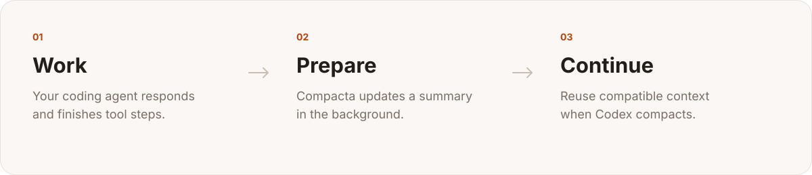
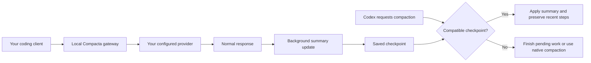

<p align="center">
  
</p>
<h1 align="center">Compacta</h1>
<p align="center"><strong>Prepare context. Keep building.</strong></p>
<p align="center">A native macOS companion that prepares conversation summaries<br>while your coding agent works.</p>
<p align="center">
  <a href="LICENSE">MIT license</a> · Apple Silicon · macOS 14+ ·
  <a href="docs/es/README.md">Español</a>
</p>



Long coding sessions eventually need a smaller context. Compacta keeps a summary
ready in the background, so a compatible checkpoint can be applied when Codex
requests compaction. Recent complete steps are preserved, and changed history is
checked before a summary is reused.

**Status:** early release preparation, version 1.0.4. Build from source today.
A signed, notarized public download is not available yet. The current app UI is
in Spanish. Compacta is an independent project, not an OpenAI or Anthropic product.

## Why Compacta

- **Prepare during the work.** Update a per-chat summary from completed tool
  results, completed response steps, and final answers.
- **Keep the recent details.** Preserve a complete recent suffix when it fits,
  and restore it when the conversation continues.
- **Choose the summarizer.** Configure a model, instructions, provider, and API key.
  OpenAI Responses, OpenAI-compatible Chat Completions, and Anthropic formats are supported.
- **See the activity.** A menu bar indicator and an activity view show preparation,
  token usage, estimated costs, and provider errors.
- **Control the connection.** Pause preparation or disable an integration from the
  app. Client configuration changes are backed up and reversible.

Preparation makes additional model requests. An up-to-date summary can reduce the
pause, but there is no fixed latency guarantee: pending work, large recent
outputs, provider limits, and genuinely changed history can require more work.

## Get started

You need an **Apple Silicon Mac running macOS 14 or later**, Node.js 22 or later,
Xcode Command Line Tools, and an existing coding-client account or provider API key.
Bun is pinned in the npm lockfile and installed by `npm ci`.

```sh
git clone https://github.com/manomx/compacta.git
cd compacta
npm ci
npm run check
npm test
npm run build
open build/Compacta.app
```

Opening the app installs it into `~/Applications/Compacta.app` and starts its
per-user background service. In the setup screen, select Codex, Claude Code, or
both. Choose a model your account can access and test the provider connection
before enabling the integration.

For a **new Codex installation**, start a new chat after activation; existing
chats keep their connection. **Claude Code needs a new session.** An existing
legacy Compacta bridge can switch workers without restarting Codex.
See [installation and removal](docs/INSTALLATION.md) for the full procedure.

## How it works



The Codex integration leaves ordinary conversation requests intact. It applies a
prepared summary when the client requests compaction. Each chat has one ordered
preparation chain; setting Codex concurrency to `0` removes the global cap.
Provider-side limits still apply.

The **Claude Code integration is different**: it replaces a prepared prefix at a
configured threshold and retains recent messages and complete tool groups. Its
native-client behavior has less validation than the Codex path.
[Read the architecture](docs/ARCHITECTURE.md).

## Privacy and costs

Compacta runs a loopback gateway and stores state on your Mac. It has no
project-operated cloud backend or analytics collector in this source tree.
Conversation requests and summary content still go to the provider you configure.
Selecting another summarizer can send conversation and tool content to that
additional provider. Some native compaction state also requires the original
Codex provider.

API keys are stored in macOS Keychain. The app can read existing client
credentials for account-backed requests and quota checks. Local checkpoints,
recent context, backups, and usage records are sensitive data; file permissions
are not encryption at rest.

Summary requests consume provider quota or API credit. Displayed dollar amounts
are editable API-equivalent estimates, not your subscription bill.
See [privacy](docs/PRIVACY.md), [configuration](docs/CONFIGURATION.md), and
[known limitations](docs/LIMITATIONS.md).

## Development

```sh
npm run check          # repository hygiene and local documentation links
npm test               # isolated engine, transport, provider, and policy tests
npm run test:installer # Swift installer copy/rollback tests; does not install the app
npm run build          # native app + compiled service, no obfuscation
npm run verify:package # isolated compiled-service checks; localhost providers only
npm run verify:replay  # synthetic checkpoint replay regression, no personal chats
npm run distribute    # local developer ZIP/DMG under dist/
```

The automated tests use synthetic transcripts and temporary homes. They do not
need a paid account. Compiling is separate from installing: `npm run build` does
not activate a service or change your client configuration.

| Directory             | Purpose                                                     |
| --------------------- | ----------------------------------------------------------- |
| `Sources/Compacta/`   | SwiftUI/AppKit app, menu bar state, installer               |
| `Sources/Vault.swift` | Keychain helper                                             |
| `service/native/`     | Codex gateway, checkpoint chain, recent-context recovery    |
| `service/`            | Providers, Claude path, configuration, quotas, usage ledger |
| `service/test/`       | Synthetic regression tests                                  |
| `scripts/`            | Build, package, and verification tools                      |
| `docs/`               | Setup, architecture, privacy, release process, brand assets |

## Contributing

Bug reports, reproducible cases, documentation, and focused pull requests are
welcome. Read [CONTRIBUTING.md](CONTRIBUTING.md) and the
[code of conduct](CODE_OF_CONDUCT.md) first. Report security problems privately as
described in [SECURITY.md](SECURITY.md). Never attach account tokens or raw chats
to a public issue.

See the [verification scope](docs/VERIFICATION.md), [roadmap](docs/ROADMAP.md),
and [changelog](CHANGELOG.md). Maintained by
[Armando Marroquín Benavides (@manomx)](https://github.com/manomx).

## License

Compacta source is released under the [MIT license](LICENSE). Bundled fonts,
JavaScript dependencies, and the Bun runtime retain their own licenses; see
[third-party notices](THIRD_PARTY_NOTICES.md). The [brand guide](docs/BRAND.md)
contains the logo sources and attribution guidance.
